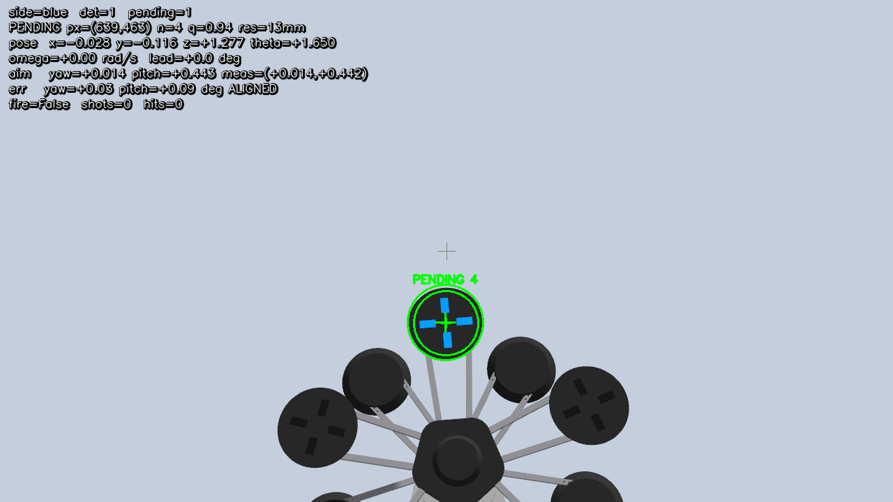
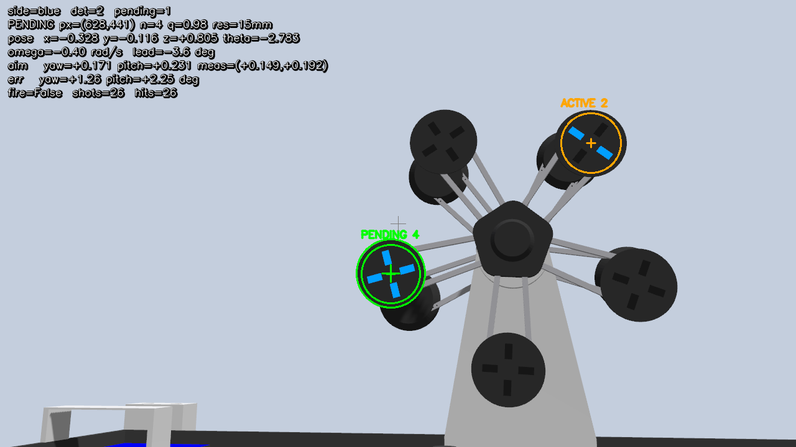
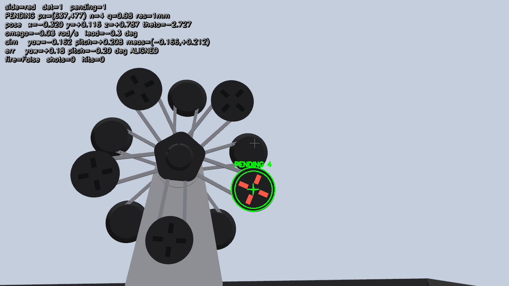

# ROBOMINI 能量机关 · 传统视觉自瞄（Algorithm_A）

面向 `robomini_sim` 仿真环境的完整自瞄链路：

**相机取图 → HSV 灯条识别 → 待激活/已激活分类 → 待激活靶位姿解算 → 枪管 yaw/pitch 解算 → 自动开火 → 命中下一靶**

只用传统视觉（HSV 阈值 + 连通域 + 聚类 + 几何反投影），不依赖深度学习；控制所需信息只来自相机、相机内参和云台关节角，**不使用 `/rune/state` 做控制**（该话题仅用于可选的精度对比诊断）。

> 学习/阅读顺序、逐函数讲解和动手实验：见 [docs/READING_GUIDE.md](docs/READING_GUIDE.md)。

---

## 0. 完成情况

| 要求 | 实现 |
|---|---|
| 识别待激活 / 已激活灯效 | 待激活 = 4 根灯条（十字）；已激活 = 2 根切向灯条；`off` 不输出 |
| 在图中显示 | 绿色圈 `PENDING 4`、橙色圈 `ACTIVE 2`，HUD 显示像素/位姿/角度/误差/命中数；发布 `/vision/debug_image`，可存图 |
| 调用仿真相机 | 订阅 `/camera/image_raw` + `/camera/camera_info`（SensorDataQoS） |
| 结算待激活靶位姿 | 像素 → 射线 → 与靶面 `y=∓0.116` 求交 → 吸附到半径 0.35 m 的机关圆 → 位置 + 姿态；发布 `/vision/target_pose` |
| 计算枪管转角 | 迭代枪口位置 + 含重力补偿的弹道解算，得到关节 `yaw/pitch` |
| 击打各个能量机关 | `mode=2` 自动开火；固定靶 / 随机固定靶 / 小机关 / 大机关均实测命中 |
| 蓝红双方 | `side:=blue/red`，两条边均验证 |

实测（本机 Gazebo Harmonic 8.15 + ROS 2 Jazzy，自动推进开启）：

| 场景 | 时长 | 命中 | 发弹 | 总分 | 阶段命中分布 |
|---|---|---|---|---|---|
| 蓝方 | 22 s | **31** | 31 | **1500** | fixed 5 / random_fixed 5 / small 11 / big 10 |
| 红方 | 20 s | **26** | 26 | **1210** | fixed 5 / random_fixed 5 / small 10 / big 6 |

> 命中数/分数会随 `auto_advance` 和运行时长继续累加；上表是停止节点时的快照。







---

## 1. 快速开始

### 1.1 环境

- Ubuntu 24.04、ROS 2 Jazzy
- Gazebo Harmonic（ros-jazzy 的 `gz_*_vendor`，8.15）
- `robomini_sim` 已构建并可启动
- 系统 Python 3.12 + `cv_bridge` + OpenCV（ROS Jazzy 自带）

```bash
conda deactivate                    # 不要用 conda 的 Python/OpenCV/Ruby
source /opt/ros/jazzy/setup.bash
source ~/Gitclone/Vision_robomini/robomini_sim/ros2_ws/install/setup.bash
```

### 1.2 构建

```bash
cd ~/Gitclone/RoboMini_DoNotCrossMeTeam/members/Algorithm_A/code
./build.sh
```

`build.sh` 会强制使用 `/usr/bin/python3`，并 source 仿真工作区（提供 `robomini_interfaces`）。

### 1.3 运行

```bash
# 终端 1：仿真（无头；需要 GUI 加 gui:=true）
cd ~/Gitclone/Vision_robomini/robomini_sim
ros2 launch robomini_sim sim.launch.py

# 终端 2：自瞄
cd ~/Gitclone/RoboMini_DoNotCrossMeTeam/members/Algorithm_A/code
./run.sh                          # 蓝方，自动开火
./run.sh side:=red                # 红方
./run.sh fire:=false              # 只识别/瞄准，不开火
./run.sh show_window:=true        # 本地 OpenCV 窗口
./run.sh save_dir:=$PWD/Pic/vision_debug
```

也可以用 launch 覆盖更多参数：

```bash
ros2 launch robomini_vision aim.launch.py \
  side:=blue fire:=true show_window:=false \
  save_dir:=$HOME/Gitclone/RoboMini_DoNotCrossMeTeam/members/Algorithm_A/code/Pic/vision_debug
```

---

## 2. 目录结构

```
code/
├── README.md                     # 本文件
├── docs/READING_GUIDE.md         # 代码阅读指南（先看这个）
├── build.sh                      # 编译（强制系统 Python + 仿真 overlay）
├── run.sh                        # 启动自瞄节点
├── color_detection.py            # 已有的 HSV 调参小工具（滑动条）
├── Pic/vision_debug/             # 实测截图
│   ├── fixed_pending.png
│   ├── pending_active_26hits.png
│   └── red_pending.png
└── ros2_ws/
    └── src/robomini_vision/
        ├── package.xml / setup.py / setup.cfg
        ├── config/params.yaml
        ├── launch/aim.launch.py
        ├── robomini_vision/
        │   ├── detector.py       # HSV + 连通域 + 聚类 + 状态分类 + 画图
        │   ├── geometry.py       # 相机/靶面几何、位姿、弹道、投影
        │   └── aim_node.py       # ROS 节点：跟踪、预测、开火、调试输出
        └── test/
            ├── test_detector.py
            └── test_geometry.py
```

运行测试：

```bash
cd ros2_ws/src/robomini_vision
/usr/bin/python3 -m pytest -q      # 16 passed
```

---

## 3. 算法细节

### 3.1 灯条分割（传统视觉）

1. BGR → HSV；
2. 按队伍颜色阈值：
   - 蓝：`H∈[93,117]`、`S≥120`、`V≥150`（蓝场线在 `H≈120`，被排除）；
   - 红：`H∈[0,8]∪[172,180]`、`S≥150`、`V≥150`（红场线与灯条同色相，靠下一步过滤）；
3. `3×3` 开运算；
4. 连通域 → 过滤面积 `45~1800 px`、长宽比 `0.2~5` 的灯条；
5. **颜色纯度过滤**：场线是纯红/纯蓝（G 通道≈0），灯条带白（蓝灯 G≈159，红灯 G≈89）；用组件平均 G 通道 `< min_green(25)` 剔除场线。这是仿真颜色下的关键一步，否则红色场线会被误识别成“已激活”。

### 3.2 灯条聚类与状态分类

- 单链接聚类：两个灯条中心距离 `< cluster_eps(85 px)` 归为同一块靶；
- 对每簇：
  - 中心 = 灯条面积加权质心（四灯条对称于靶心，两灯条中点也等于靶心）；
  - PCA 特征值比 `minor/major` 描述“是否二维展开”；
  - **≥4 根**，或 3 根且 ratio ≥ 0.12 → `pending`；
  - **2 根** → `active`；
  - 单根/其它 → 忽略。
- 置信度 `quality` 由面积和 ratio 计算，节点只对 `n_bars ≥ 4` 且 `quality ≥ 0.45` 的 pending 开火。

### 3.3 待激活靶位姿

相机在 `pitch_link` 上，`pitch_link` 本身绕俯仰关节轴转动：

```
P0 = (0, ∓2.07, 0.495)           # pitch=0 时 pitch_link 原点
C  = P0 + (0, 0, 0.145)          # 俯仰关节轴（SDF joint pose 相对 child link）
R  = Rz(β+yaw) · Rx(pitch)
pitch_origin = C + R·(P0 − C)    # pitch_link 原点随俯仰产生的平移
相机位置 = pitch_origin + R·(0, 0.036, 0.075)
相机姿态 = R · R_ROS_IN_PL
```

其中 `β = 0`（蓝）/ `π`（红），`R_ROS_IN_PL` 把 ROS 光学系（x 右、y 下、z 前）转换到 `pitch_link`
（相机在模型里还绕 Z 转了 +90°）。像素射线为

```
d_ros = normalize((u-cx)/fx, (v-cy)/fy, 1)
```

与靶面 `y = -0.116`（蓝）/ `+0.116`（红）求交，再**吸附到机关圆**：

```
θ = atan2(z - 0.928, x - 0)
P = (0.35·cosθ, y_plane, 0.928 + 0.35·sinθ)
```

若交点与圆的距离 `> max_snap_error(0.05 m)`，判为该侧靶面之外的干扰（例如背面），丢弃。
姿态由 `x=径向、y=切向、z=靶面法向` 构造四元数，发布为 `PoseStamped`（`frame_id: world`；工程无 TF）。

> **为什么用关节角而不是 `GimbalToVision.q`？**
> 仿真里红方 `pitch_link` 的 IMU 四元数只包含俯仰（以及 yaw 关节），**没有包含红方模型的 180° 安装偏航**；蓝方恰好 β=0 所以看不出来。用测得的 `yaw/pitch` + 已知 β 组合，双方一致且与物理完全对齐。代码里保留了 `GimbalToVision.q` 的订阅接口，但位姿只用关节角。

### 3.4 枪管转角

枪口随俯仰关节移动（与相机共用同一个 `pitch_origin`）：

```
muzzle = pitch_origin + R·(0, 0.095, 0)
```

> 注意 `0.145`：SDF 的 `<joint><pose>` 是相对 child link 的，俯仰轴在
> `pitch_link` 原点上方 0.145 m，并不在原点。`geometry.py` 的
> `PITCH_PIVOT_OFFSET` / `pitch_link_origin()` 专门补这段平移；少了它会
> 让枪口在 pitch≈0.3 rad 时偏差约 4 cm。

对目标点迭代 6 次：

1. 由 `muzzle → target` 的水平位移求 `yaw`（蓝方前方 +Y、红方 −Y，`yaw` 正 = 向左）；
2. 解弹道俯仰（与 Gazebo 插件同一无阻力模型）：

```
dz = d·tan(θ) - g·d² / (2·v²·cos²θ),  θ ∈ [-10°, +45°]
```

3. 用新 pitch 更新 muzzle，重复。

### 3.5 运动目标预测（small / big）

- 对连续检测的 `θ` 做 0.7 s 窗口线性拟合，得到 `ω = dθ/dt`；
- 预测 `θ_pred = θ + ω·(t_flight + lead_latency)`，其中 `t_flight ≈ 水平距离 / 12 m/s`，`lead_latency=0.06 s`；
- 同时把瞄准角速度作为 `yaw_vel/pitch_vel` 前馈发给云台；
- 目标切换用“与预测值跳变 > 0.4 rad”检测并重置跟踪，避免把旧目标的速度带到新目标。

### 3.6 开火与重捕获

- 对准判据：`|yaw 误差|`、`|pitch 误差|` 均 `< 0.022 rad`（约 1.26°）；
- 开火条件：`fire=true` + 对准 + 当前帧 pending + `n_bars≥4` + `quality≥0.45` + 连续 2 帧稳定；
- 发布 `mode=2`，`launcher_node` 以 3 发/s 节流；条件不满足立即回到 `mode=1`；
- 命中后新 pending 可能不在视野内：超过 `search_timeout=0.5 s` 没看到 pending 时，自动把云台指向机关中心 `(0, ∓0.116, 0.928)`，让 5 个靶重新进入视野，再锁定新 pending。

---

## 4. ROS 接口

### 订阅

| 话题 | 类型 | 说明 |
|---|---|---|
| `/camera/image_raw` | `sensor_msgs/Image` | SensorDataQoS，1280×720@60 |
| `/camera/camera_info` | `sensor_msgs/CameraInfo` | 内参 |
| `/gimbal_to_vision` | `robomini_interfaces/GimbalToVision` | 实测 yaw/pitch、弹数 |
| `/rune/hit` | `robomini_interfaces/RuneHit` | 命中统计（仅显示） |
| `/rune/state` | `robomini_interfaces/RuneState` | **仅当** `compare_ground_truth:=true` 时用于诊断 |

### 发布

| 话题 | 类型 | 说明 |
|---|---|---|
| `/vision_to_gimbal` | `robomini_interfaces/VisionToGimbal` | `mode 1/2` + yaw/pitch + 前馈 |
| `/vision/debug_image` | `sensor_msgs/Image` | 带识别框/HUD 的调试图（默认 10 Hz） |
| `/vision/target_pose` | `geometry_msgs/PoseStamped` | 待激活靶位姿（世界系，无 TF） |

查看：

```bash
ros2 run rqt_image_view rqt_image_view /vision/debug_image
ros2 topic echo /vision/target_pose --once
ros2 topic echo /rune/hit
```

---

## 5. 主要参数（`config/params.yaml`）

| 参数 | 默认 | 说明 |
|---|---|---|
| `side` | blue | blue / red，必须与仿真 `side` 一致 |
| `ball_speed` | 12.0 | 弹速 m/s，需与发射架设置一致 |
| `fire` | true | 是否自动开火 |
| `fire_tolerance` | 0.022 | 对准阈值 rad |
| `min_quality` | 0.45 | pending 置信度阈值 |
| `min_fire_bars` | 4 | 开火要求完整四灯条 |
| `lead_latency` | 0.06 | 额外提前量 s |
| `search_timeout` | 0.5 | 丢失目标后回机关中心的时间 s |
| `track_memory` | 0.35 | 短时失检时按上次速度外推 s |
| `max_snap_error` | 0.05 | 吸附到机关圆的最大残差 m |
| `process_rate` | 20.0 | 图像处理频率 Hz（相机 60 Hz） |
| `debug_rate` | 10.0 | 调试图频率 Hz |
| `save_dir` | "" | 非空则周期保存标注图 |
| `compare_ground_truth` | false | 仅诊断：与 `/rune/state` 比较误差 |

---

## 6. 实测结果与说明

- 蓝方：22 s 内 **31 中 / 31 发**（裁判计分），总分 **1500**；固定靶、随机固定靶各 5 中，小机关 11 中，大机关 10 中；节点停止时已进入下一轮 small。
- 红方：20 s 内 **26 中 / 26 发**（裁判计分），总分 **1210**；固定靶、随机固定靶各 5 中，小机关 10 中，大机关 6 中。
- 开火节奏受 `launcher_node` 的 3 发/s 限制，命中率高的主要原因是：
  1. 位姿用“射线 + 靶面 + 机关圆”约束，位置误差在毫米级；
  2. 弹道模型与 Gazebo 插件一致（无阻力、g=9.81）；
  3. 运动目标有角速度前馈 + 落点提前量；
  4. 只在 `n_bars=4` 且对准时开火，避免打偏/打错靶。
- CPU：20 Hz 处理 + 10 Hz 调试图时约 0.6 核（`process_rate`、`debug_rate` 可继续降低）。
- 单元测试：`16 passed`（几何往返、弹道命中、HSV 待激活/已激活、场线过滤）。

> 测试时 `auto_advance=true`，打完 5 靶会自动进入下一阶段，因此分数/阶段命中数会持续增长；表中是停止时刻的快照。

---

## 7. 调试

```bash
# 看识别效果
ros2 run rqt_image_view rqt_image_view /vision/debug_image

# 看位姿
ros2 topic echo /vision/target_pose --once

# 看瞄准/命中
ros2 topic echo /gimbal_to_vision --once
ros2 topic echo /rune/hit

# 与真值对比（仅诊断，不参与控制）
./run.sh compare_ground_truth:=true
# 日志会打印 gt_err=xx mm

# 存标注图
./run.sh save_dir:=$PWD/Pic/vision_debug save_every:=2.0

# 只识别不射击
./run.sh fire:=false

# 本地窗口
./run.sh show_window:=true
```

HSV 调参可继续用已有的 `code/color_detection.py`（滑动条工具），把新阈值填到 `detector.py` 的 `TEAM_HSV` 或节点参数。

---

## 8. 已知限制与改进方向

1. **HSV 阈值是仿真颜色标定的**：实车灯光色温/曝光变化大，建议加白平衡、亮度归一化，或按亮度自适应阈值。
2. **位姿用了“靶面平面 + 机关圆”先验**：在仿真里非常稳；若相机大角度斜视、靶板倾斜或需要完整 6D 位姿，建议检测靶板四角后 `solvePnP`，与本方法互为校验。
3. **预测是线性外推**：大机关是正弦变速，`ω` 变化快时提前量有滞后；可换 Kalman/常加速度模型，或直接拟合 `a·sin(ωt+φ)`。
4. **无 TF**：相机外参按模型尺寸硬编码（`0.036, 0.075`、`+90°`）。若修改 `launcher/model.sdf` 的相机安装位置，需要同步 `geometry.py` 的 `CAMERA_OFFSET` / `R_ROS_IN_PL`。
5. **相机与枪口有视差**：本实现直接用枪口解弹道，不用相机位置当枪口；相机只负责测角。
6. **IMU 四元数在红方缺少安装偏航**：本实现改用关节角，避免该问题；如果未来要接实车 IMU，需要确认其坐标系定义。
7. **CPU**：主要开销在 60 Hz 图像反序列化和 720p 调试图；可降低 `process_rate`、`debug_rate`，或只在需要时开 `debug_image`。

---

## 9. 文件说明

| 文件 | 作用 |
|---|---|
| `robomini_vision/detector.py` | HSV 分割、连通域、聚类、pending/active 分类、画框/HUD |
| `robomini_vision/geometry.py` | 相机位姿、像素↔世界、靶面/机关圆、弹道、枪口、投影 |
| `robomini_vision/aim_node.py` | ROS 节点、跟踪/预测、开火状态机、调试图/位姿发布 |
| `config/params.yaml` | 全部可调参数 |
| `launch/aim.launch.py` | 启动参数 |
| `test/test_detector.py` | 合成灯条/场线的检测测试 |
| `test/test_geometry.py` | 投影往返、弹道、位姿四元数测试 |
| `color_detection.py` | 原有 HSV 滑动条调参工具 |
